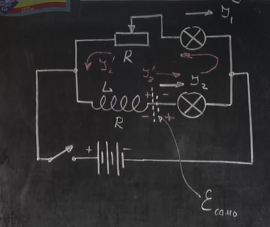
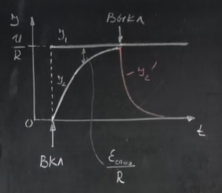
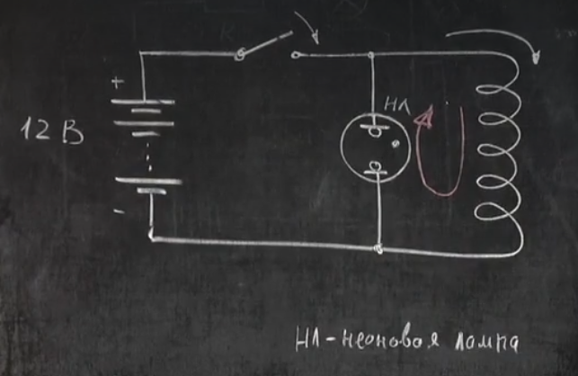
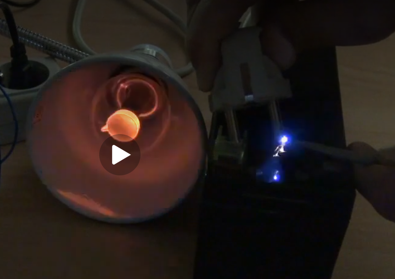
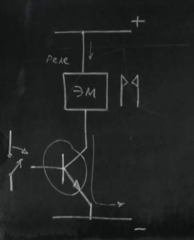
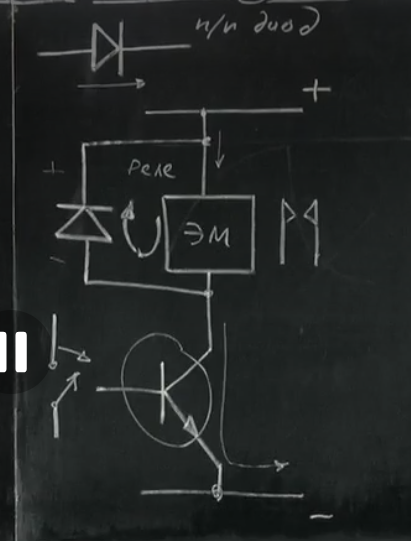
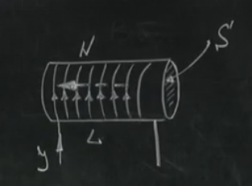

# Урок 288. Явище самоіндукції (завершення). Задачі на індуктивність
# чому коли по котушці починає текти струм, вона протидіє йому певний час? як зрозуміти це інтуїтивно?

Пояснення

## Головна ідея: котушка "не любить" зміни

Уявіть котушку не як провід, а як щось, що **зберігає інформацію про струм** у вигляді магнітного поля. Поки струм один і той самий — котушці байдуже. Але щойно струм намагається змінитися — котушка цьому опирається.

## Аналогія з маховиком (найкраща)

Уявіть важкий маховик (диск), з'єднаний з валом мотора через якийсь передавальний механізм, де:
- **обертання вала** = електричний струм
- **швидкість обертання маховика** = сила струму
- **зусилля, яке докладає мотор** = напруга

Коли ви вмикаєте мотор, маховик не може миттєво розкрутитися до потрібної швидкості — у нього є **інерція** (маса). Мотору доводиться прикладати додаткове зусилля, щоб "продавити" цю інерцію. Чим важчий маховик — тим довше розгін.

Так само й котушка: вона має "електричну інертність" (індуктивність), і щоб змусити струм зрости, джерело напруги має "продавити" цю інертність.

## Чому саме так — фізична причина

Тут аналогія не випадкова, а має реальну фізичну основу:

1. Струм тече → навколо провідника виникає магнітне поле.
2. Магнітне поле — це **накопичена енергія** (як кінетична енергія маховика).
3. Щоб струм зріс, треба **збільшити** цю енергію поля.
4. А щоб збільшити енергію будь-якого поля — потрібен час і "робота" з боку джерела.

Тобто котушка чинить опір зміні струму не тому, що вона "хоче нашкодити", а тому, що **зміна струму = зміна запасеної в полі енергії**, а миттєва зміна енергії означала б нескінченну потужність — а так не буває.

## Ще простіше: "напруга — це плата за зміну"

Можна запам'ятати так:
> Котушка видає напругу *у відповідь* на **швидкість зміни** струму, а не на сам струм.

Якщо струм не змінюється (навіть якщо він великий) — котушка "мовчить", напруги на ній нема. Якщо струм змінюється різко — котушка "кричить" великою напругою, яка протидіє цій зміні.

Це схоже на те, як важко зрушити з місця важкий візок (потрібна сила), але коли він вже котиться з постійною швидкістю — тримати його не треба, він котиться сам.

## Підсумок інтуїції

| Механіка | Електрика |
|---|---|
| Маса | Індуктивність |
| Швидкість | Струм |
| Сила | Напруга |
| Інерція опирається зміні швидкості | Котушка опирається зміні струму |

Коли ви це відчуваєте через призму інерції — вся поведінка котушки (і затримка, і "викид" напруги при вимиканні) стає інтуїтивно зрозумілою.

---
---
---

# якщо розірвати коло із котушкою, заряд залишиться на котушці?

Пояснення

Гарне запитання, і тут криється поширена плутанина — важливо розрізнити **котушку** і **конденсатор**.

## Коротка відповідь: ні, заряд не "залишається"

Конденсатор справді може зберігати **заряд** (розділені +/− заряди на обкладинках) навіть після розриву кола — тому старий телевізор чи блок живлення може "вдарити" струмом, навіть коли вимкнений з розетки.

Котушка працює **інакше**. Вона не зберігає заряд — вона зберігає енергію у вигляді **магнітного поля**, яке існує, поки через неї тече струм.

## Що насправді відбувається при розриві кола

Тут якраз проявляється та сама "інерція", про яку ми говорили. Котушка **не хоче**, щоб струм миттєво зник до нуля — вона намагається підтримати його.

Але якщо коло розірвано (наприклад, вимикачем), то струму просто **немає куди текти** — ланцюг перерваний. А котушка все одно "наполягає" на тому, щоб струм тік.

Результат — **різкий сплеск напруги** (іноді дуже великий, у сотні й тисячі вольт), який котушка генерує, намагаючись протиснути струм через розрив. Саме тому:

- на контактах вимикача часто проскакує **іскра** — це і є той сплеск напруги, що пробиває повітряний проміжок;
- у реле, електромагнітних клапанах, двигунах при вимиканні виникають потужні викиди напруги, які можуть пошкодити електроніку (тому паралельно котушці часто ставлять діод — "діод вільного ходу" — щоб дати струму куди стекти плавно).

## Аналогія з маховиком знову працює

Уявіть, що вал з маховиком раптом **обривається** (механічне з'єднання зникає). Маховик за інерцією все одно намагається обертатися — вся накопичена енергія має кудись піти. У механіці вона перетвориться на тепло від тертя чи вібрацію. В електриці — енергія магнітного поля перетворюється на іскру, тепло, іноді на шкоду для компонентів.

## Підсумок

| | Конденсатор | Котушка |
|---|---|---|
| Що зберігає | Заряд (і енергію електричного поля) | Енергію магнітного поля (не заряд!) |
| Після розриву кола | Заряд може залишатись довго | Струм не може "залишитись" — енергія миттєво вивільняється у вигляді сплеску напруги/іскри |

Тобто заряд на котушці не "залишається" в сенсі накопичення — натомість енергія, яка була в магнітному полі, різко вивільняється в момент розриву.

---
---
---

  
  
Коли ми розриваємо коло з котушкою, вона намагається зберегти струм і створює ЕРС, яка напрямлена в напрямку струму. І ця ЕРС створює струм $I'_2$. Цей струм з часом буде плавно зменшуватися. Цей струм буде текти по колу, в якого вдвічі більший опір (котушки + резистора). Оскільки струм в момент перемикання на максимумі. ЕРС самоіндукції при вимиканні перемикача моментально міняє напрямок та збільшується в 2 два рази (бо опір при тому ж струмі вдвічі більший).   
Що було б, якби опір цього кола збільшився не в 2 рази, а в 100 разів?  
Оскільки струм має залишитися тим же, ЕРС самоіндукції при вимиканні перемикача моментально збільшилася б у 100 разів.

## Різкий розрив кола з неоновою лампою  
  
В неонових лампах нижча інерція ніж у лампах розжарювання, тому вони швидше починають світити, якщо на них подати напругу. Лампа не дуже сильно світить навіть від 220В. Ми подамо на неї 12 вольт. Напруги 12 вольт не достатньо, щоб неонова лампа загорілась (їй треба хоча б 100 вольт). Котушка накопичить магнітне поле, і коли ми розриваємо коло, котушка створить ЕРС самоіндукції, яка створить струм, який піде через неонову лампу. Опір неонової лампи дуже великий, тому щоб зберегти струм, який був до розриву кола, котушка створить ЕРС самоіндукції, яка буде в багато разів більшою ніж напруга джерела. І неонова лампа загориться.
На фото показано момент розривання кола  
  
Можна побачити, що на розриві контакту також створюється іскра. Це відбувається тому, що котушка створює ЕРС самоіндукції, яка намагається зберегти струм, який був до розриву кола. Іскра виникає тому, що повітря не є ідеальним ізолятором і при великій напрузі воно пробивається.

## Як уникнути псування електроніки 
  
На малюнку показано, що ми розмикаємо коло з електромагнітним реле за допомогою транзистора. Після розмикання кола (на базу не подається струм), транзистор має дуже високий опір. І інертність котушки призведе до того, що на колекторі транзистора виникне велика напруга, яка може його пошкодити і навіть спалити.  

Для того, щоб цього уникнути використовують напівпровідниковий діод, через нього струм може текти тільки в один бік. І коли ми розриваємо коло, струм від котушки потече через діод, і не буде великої напруги на колекторі транзистора.  

# чи можна сказати, що коли ми розриваємо коло, в якому є котушка індуктивності і в ньому різко стає великий опір, це можна порівняти з тим, що ми наприклад різко поставимо стінку перед м'ячиком, що котиться по інерції і він сильно в неї влупиться. А якщо опір не великий - це наче він повільно гальмує силою тертя? І влупитися в стінку - це наче розірвати різко транзистор і вся енергіє струму різко витратиться на транзисторі з великою потужністю (бо потужність це добуток струму та напруги, а напруга дуже сильно збільшиться)?

Пояснення

Так, аналогія дуже влучна, і фізика тут працює майже один в один. Розберу по пунктах.

**Головна ідея — інерція**

Струм в котушці індуктивності — це майже точний аналог швидкості тіла, яке рухається за інерцією. Котушка "не любить" різкої зміни струму так само, як тіло "не любить" різкої зміни швидкості. Формально:

- Механіка: F = m·(dv/dt)
- Котушка: U = L·(dI/dt)

Це та сама структура рівняння: чим різкіше змінюється швидкість (чи струм), тим більша сила (чи напруга) виникає.

**Різкий обрив = стінка**

Коли ти різко ставиш велике або нескінченне (обрив кола) значення опору, ти змушуєш dI/dt бути величезним за дуже малий час — котушка "чинить опір" цьому через закон індукції і видає величезний сплеск напруги, щоб хоч якось "протягнути" струм ще трохи. Це справді як зіткнення зі стінкою: різка зупинка → велика сила за короткий час.

**Плавне гальмування через тертя = невеликий опір**

Якщо опір помірний, струм спадає експоненційно з постійною часу τ = L/R. Чим менший R, тим повільніше (більше τ) спадає струм — це справді як тертя: енергія розсіюється поступово, розтягнуто в часі, без різкого піку напруги.

**Транзистор і потужність**

Тут твоя інтуїція теж правильна, і це реальна інженерна проблема, а не тільки аналогія:

- Енергія, запасена в котушці, дорівнює ½·L·I² — і вона нікуди не зникає, а має десь розсіятись.
- Якщо транзистор різко закривається (стає "великим опором"), котушка намагається підтримати той самий струм, і напруга на транзисторі різко зростає, іноді до сотень вольт.
- Миттєва потужність P = U·I на транзисторі в цей момент може бути величезною, хоча енергія та сама — просто вона виділяється за дуже малий проміжок часу і саме на цьому елементі.
- Це реально спалює транзистори — явище називають "індуктивний викид" (inductive kick / inductive spike). Саме тому в реальних схемах (реле, соленоїди, двигуни) паралельно котушці ставлять діод (flyback diode) — він дає струму "м'який шлях" для спаду замість різкого обриву через транзистор.

Тобто твоя аналогія:
- обрив кола ≈ стінка (різка зупинка, великий "удар" по опору/транзистору)
- малий опір ≈ тертя (плавне гальмування)
- транзистор без захисту ≈ стінка, яка сама приймає весь удар і може від цього "розбитися" (згоріти)

— цілком коректна і навіть використовується в реальній інженерній практиці для пояснення, чому потрібен flyback-діод.

---
---
---

# але чому швидка витрата енергії з більшою потужністю шкодить, а повільна - ні?

Пояснення

Дуже слушне питання — і тут справді криється нюанс: **та ж сама енергія може шкодити по-різному залежно від швидкості її вивільнення**, і причин тому дві, різної природи.

**1. Перевищення напруги пробою — це не про тепло взагалі**

Коли струм обривається різко, миттєва напруга на транзисторі може підскочити до сотень вольт — і якщо вона перевищить максимально допустиму напругу переходу (breakdown voltage), відбувається **пробій**: структура напівпровідника фізично руйнується (прогорає канал, плавиться доріжка), незалежно від того, скільки там енергії. Це як перевищити межу міцності матеріалу — не важливо, скільки джоулів, важливо, що тиск/напруга перевищили поріг, після якого структура ламається.

Аналогія: не так важливо, скільки енергії має куля, важливо, чи перевищує тиск в точці удару межу міцності скла. Мала куля на великій швидкості пробʼє скло, а та ж енергія, розтягнута на секунду (наприклад, повільний тиск руки), скло не поламає.

**2. Тепло не встигає "розповзтися" — це вже питання швидкості**

Навіть якщо напруга не перевищує пробій, є тепловий ефект:

- Тепло виникає в дуже маленькому обʼємі — в p-n переході транзистора, товщиною в мікрони.
- Щоб тепло розсіялося, потрібен час — воно має "розповзтися" по кристалу, корпусу, радіатору.
- Якщо енергія виділяється за наносекунди-мікросекунди, тепло просто **не встигає піти нікуди** — локальна температура переходу різко стрибає (перегрів локальної точки), навіть якщо в середньому по всьому корпусу трохи тепліше.
- Якщо та сама енергія розтягнута на секунди, тепло встигає розійтися по всій масі матеріалу і піти через радіатор — середня температура зростає значно менше.

Це називається **transient thermal impedance** — тепловий опір матеріалу різний для короткого і довгого імпульсу. Умовно: чим коротший імпульс, тим менший обʼєм матеріалу "встигає" прийняти участь у поглинанні тепла, тому температура саме в цій маленькій зоні злітає вище.

**Аналогія з молотком**

Уяви, що ти маєш вдарити молотком по цвяху з енергією 10 Дж. Якщо ти вдариш різко за 0.01 секунди — тиск в точці контакту буде величезний, цвях увійде або зігнеться. Якщо ту саму енергію "розмазати" на 10 секунд (повільно тиснути рукою) — нічого не проб'ється, бо сила в кожен момент часу мала.

Тобто ключове: **енергія та сама, але потужність (енергія/час) і локальна концентрація напруги/тепла — різні**. Матеріали ламаються не від загальної кількості енергії, а від того, чи перевищує миттєва напруга/температура/тиск поріг міцності в конкретній малій точці.

---
---
---

## Генрі

$\varepsilon_{i} = - \frac{\Delta\Phi}{\Delta t}$  
$\Phi = IL$  
$\Delta\Phi = L \Delta I$  
$$\varepsilon_{i} = - L\frac{\Delta I}{\Delta t} - ЕРС\ самоіндукції\ (1)$$

Нехай $L = 1 Гн, \frac{\Delta I}{\Delta t} = 1 А/с$, тоді $|\varepsilon_{i}| = 1 В$.  
**1 Генрі** - це індуктивність такого контура, в якому рівномірна зміна сили струму на 1 А протягом 1 секунди викликає ЕРС самоіндукції 1 В.  

Із формули (1):  
$L = \frac{\varepsilon_{i} \Delta t}{\Delta I}$  
$Гн = \frac{В \cdot с}{А}$, $\frac{B}{A} = Ом$ => $Гн = Ом \cdot с$  

## Задача № 927 (Римкевич)
Через соленоїд, індуктивність якого $0,4 мГн$. І площа поперечного перерізу $10 см^2$ проходить струм $0,5 А$. Яка індукція поля всередині соленоїда, якщо він має 100 витків. Поле вважати однорідним.  

$L = 0,4 мГн = 0,4 \cdot 10^{-3} Гн$  
$S = 10 см^2 = 10 \cdot 10^{-4} м^2$  
$I = 0,5 А$  
$N = 100$

---
$B - ?$

---

  
$L = \frac{\Phi}{I}$  
$\Phi = LI$  
$\Phi_1 = BS$ - потік через один виток  
$\Phi = \Phi_1 N = BSN$ - потік через всі витки  

$BSN = LI$
$$B = \frac{LI}{SN}$$
$B = \frac{0,4 \cdot 10^{-3}Гн \cdot 0,5 А}{10 \cdot 10^{-4} м^2 \cdot 100} = 0,002 Тл = 2 мТл$